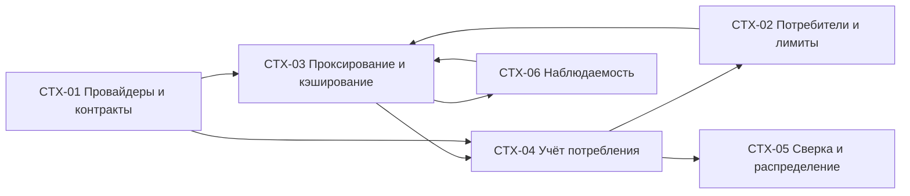

# Ограниченные контексты

Каталоги: `CTX-NN-slug/` с `readme.md` (описание контекста), `index.md` (индекс capability) и файлами `CAPNN-NN-slug.md`.

Определения — [ограниченный контекст](../../../glossary/terms/bounded-context.md), [Capability](../../../glossary/terms/capability.md). Шаблон описания контекста — [bounded-context-readme.md](../../../playbook/templates/bounded-context-readme.md).

Регламент — [product-intent-structure.md](../../../playbook/workflow/product-intent-structure.md). Навигация по репозиторию — [корневой index.md](../index.md).

## Контексты

| Id | Контекст | Смысл |
| -- | -------- | ----- |
| [CTX-01](CTX-01-providers-and-contracts/index.md) | Провайдеры и контракты | Внешние провайдеры, контракты, ключи провайдера, правила тарификации |
| [CTX-02](CTX-02-consumers-and-limits/index.md) | Потребители и лимиты | Внутренние ключи, структура подразделений, лимиты |
| [CTX-03](CTX-03-proxying-and-caching/index.md) | Проксирование и кэширование | Путь обращения: кэш, отказ или запрос к провайдеру |
| [CTX-04](CTX-04-consumption-metering/index.md) | Учёт потребления | Кто, сколько, когда и чего потребил |
| [CTX-05](CTX-05-settlement-and-allocation/index.md) | Сверка и распределение | Отчётный период, сверка с провайдером, распределение по подразделениям |
| [CTX-06](CTX-06-observability/index.md) | Наблюдаемость | Состояние провайдеров, трассы обращений |

